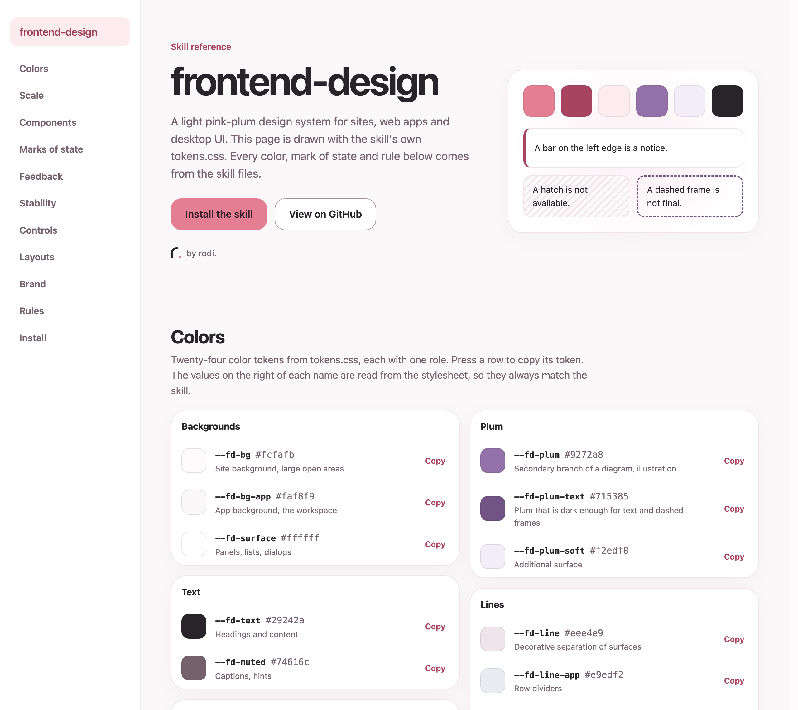

# frontend-design

Light pink-plum design system for sites, web apps and desktop UI, with CSS tokens and an interactive HTML starter.

A skill for Claude Code and Codex. The agent applies the style when you ask for a site, landing page, web app or component in it.



[Open the live demo](https://byrodi.github.io/frontend-design/)

## What you get

- A palette with roles, plus type, spacing, radius and motion scales
- CSS tokens that map onto plain CSS, Tailwind or MUI
- Two layouts from one family, a landing page and an app shell
- A self-contained HTML starter with choice cards and a live preview
- A definition of done for contrast, keyboard, mobile and reduced motion
- The [rodi. brand kit](skills/frontend-design/assets/brand/): wordmark, avatars, animated and static profile banners and a header, with the script that generates them

## How it works

1. The agent looks at the project's stack, components and content.
2. It takes the palette and scales from the design reference.
3. It maps the tokens onto the styling system the project already uses.
4. It builds the main scenario and checks narrow and wide screens.

A project with its own design system keeps it, and the skill stays out of backend work.

## Usage

The skill loads on requests like these. To call it explicitly in Claude Code, run `/frontend-design:frontend-design`.

```text
lay out a landing page in this style
build a settings screen for the web app in this style
```

## Install

Claude Code:

```sh
git clone https://github.com/byrodi/frontend-design ~/IdeaProjects/skills/frontend-design
ln -s ~/IdeaProjects/skills/frontend-design ~/.claude/skills/frontend-design
```

Codex:

```sh
ln -s ~/IdeaProjects/skills/frontend-design/skills/frontend-design ~/.agents/skills/frontend-design
```

Update with `git pull` in the clone.

## Credits and license

The skill structure was inspired by Anthropic's public [frontend-design skill](https://github.com/anthropics/skills/tree/main/skills/frontend-design). The text and code here were written from scratch.

Released under the [MIT License](LICENSE).
